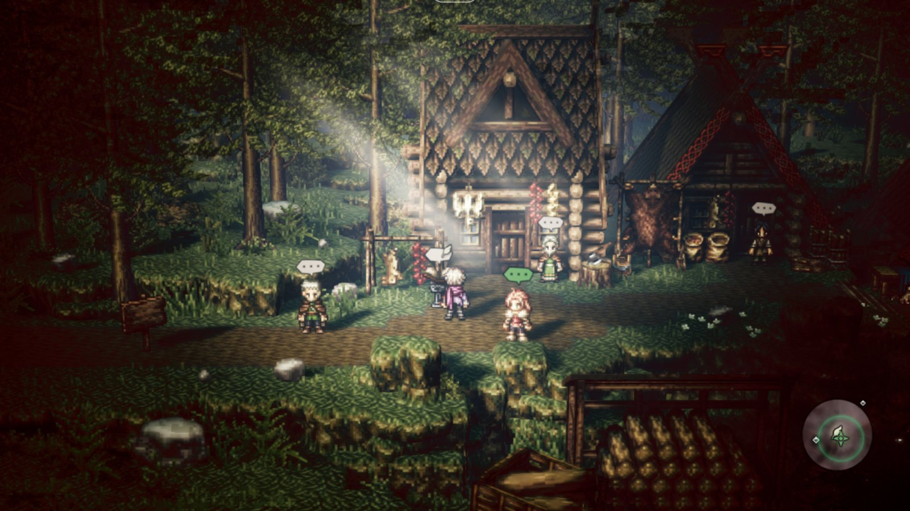
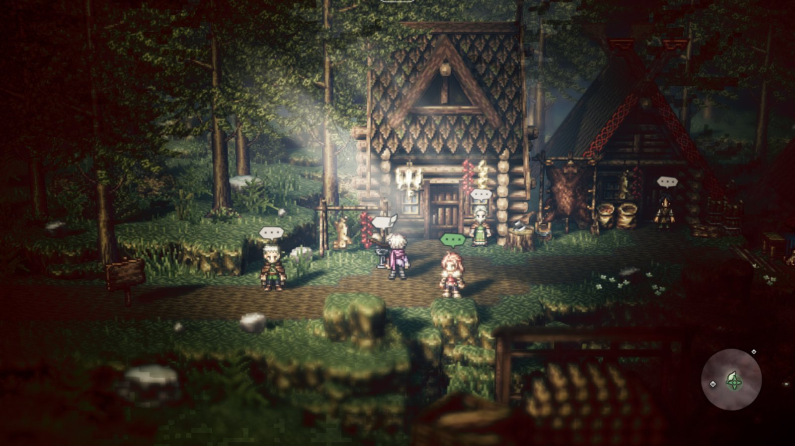
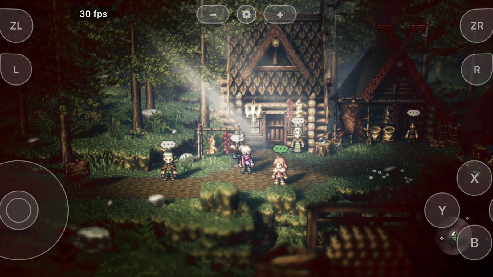
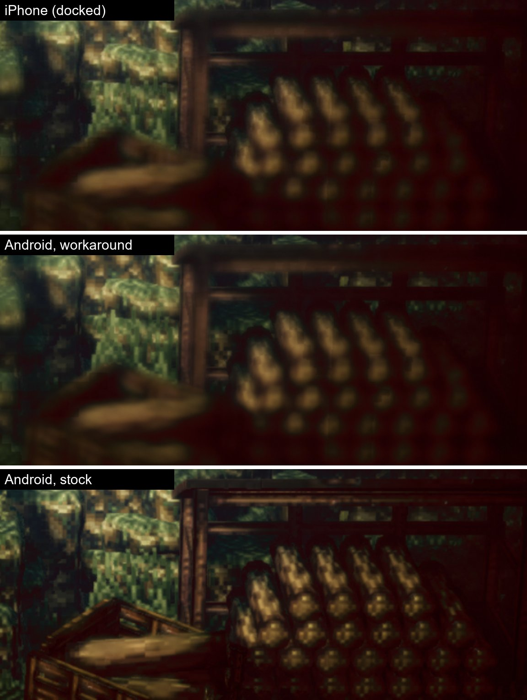
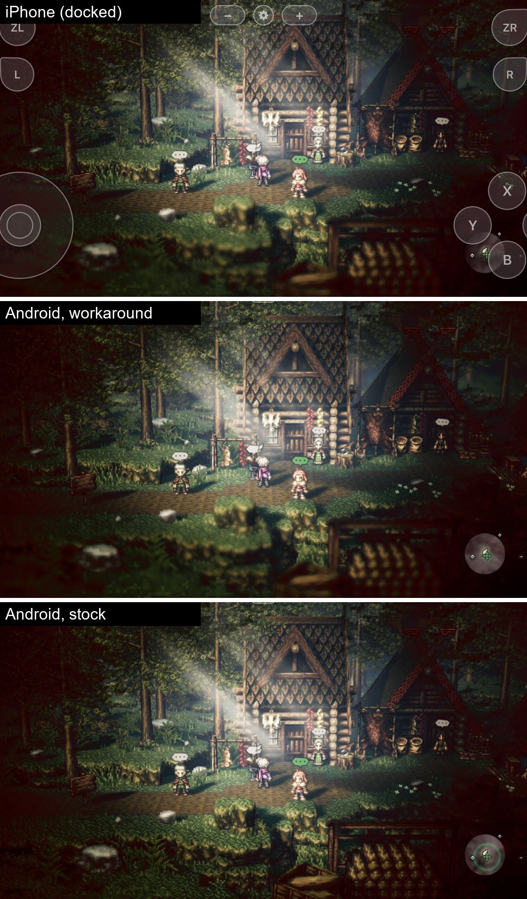

**Game:** OCTOPATH TRAVELER 1.0.5 (010057D006492000, Unreal Engine 4.18, SDK 3.5.1)
**Device:** RedMagic Astra NP05J, Adreno 830, Qualcomm driver 512.800.72 (also tried Turnip Gen8 V38 / Mesa 27.0.0, same result)
**Build:** fork `sid350/nx2android` at 28cbb7f (upstream 5181e97 + our fork commits; none of them touch the Vulkan backend or the shader chain for this game)
**Scene:** S'warkii village (H'aanit's chapter), Docked mode; Handheld is the same.

### Symptom

The field is rendered sharp on Android. Foreground foliage, the crate and the logs at the bottom and the distant trees are blurred by Unreal's Bokeh DOF on the iPhone (NXNative, Metal) and on the Switch; on the tablet they come out fully sharp. Colour, brightness, vignette, light shafts and geometry are otherwise identical to the iPhone frame (mean L 54.4 vs 53.9, mean RGB within 1 %).

| Android, stock (before) | Android with the workaround (after) | iPhone, Docked |
|---|---|---|
|  |  |  |

Foreground crop, iPhone / workaround / stock (top to bottom):

Full frames, iPhone / workaround / stock:

(Frames cropped to the 16:9 game area; the iPhone frame converted from Display P3 to sRGB. The iPhone frame still shows its on-screen gamepad.)

### Where it breaks

The DOF chain in this scene (`DM_VK_PASSDUMP`):

- pass 9: 640×360 RGBA16F, scene colour with the circle of confusion in alpha
- pass 10: 640×760 (far layer on top, near layer below), 908 instances of bokeh sprites, VS `f4cadf41d03d6cf8` / PS `4e1b25c20f5fc520` (global shader cache)
- pass 11: recombine, PS `b5609af6f03486e8`

The sprite vertex shader `f4cadf41d03d6cf8` classifies each 2×2 tile; a high-contrast tile is drawn as four sprites, a low-contrast tile as one. On Android the low-contrast branch produces sprites of size 0, so flat areas (grass, logs, the crate) contribute nothing to the blur layers, the recombine weight there is ~0 and the sharp frame stays. The depth buffer and the CoC written by pass 9 are correct (visualised on screen: large CoC in the foreground and in the distance, small in focus), and no draw or dispatch is skipped (`skipped (no program 0, no target 0, no pipeline 0)`, no RED lines).

### Ruled out

- Handheld vs Docked, reloading the save
- `DM_VK_X_NOKEEP`, `DM_VK_X_NOSETMEMO`, `DM_VK_X_NOSHC`: no change
- The bokeh texture (64×64, 7 mips, BGRA8_SRGB): mip 0 uploaded and correct
- NaN-aware min/max (732294b) applied to the four shaders of the chain: no change
- `RelaxedPrecision` / fp16: none in these shaders
- The driver's compiler: Turnip Gen8 V38 draws it exactly like the Qualcomm driver (sharpness numbers identical)

Metal on the iPhone gets its MSL from the same translated SPIR-V, so I could not find what differs; I have no way to read the shader's intermediate values on the iPhone.

### Workaround (fork)

https://github.com/sid350/nx2android/pull/5 adds an optional per-profile table `android_shader_stores.tsv` (`dm/android/tools/spv_patch.py`, applied by `shader_vk.py` when the bundle is built) that swaps one `OpStore`'s value for a constant of the module; the build stops if the ids no longer match the translator's output. For this game it replaces `OpStore %183 %681` with `%650` (true), i.e. every tile takes the four-sprite path. That matches the iPhone in every zone measured (p99 horizontal gradient on 1600×900, stock → workaround → iPhone):

| zone | stock | workaround | iPhone |
|---|---|---|---|
| logs | 19.2 | 8.9 | 9.1 |
| crate | 21.1 | 13.6 | 13.2 |
| rock | 12.5 | 8.1 | 8.5 |
| grass | 17.3 | 5.4 | 4.9 |
| distant trees | 11.5 | 9.4 | 9.2 |
| character in focus | 54.5 | 54.1 | 55.6 |

fps stays at 30 (29.7 / 30.1), GPU time per frame 8.8 → ~11 ms. Only S'warkii was checked, about three minutes, no battle.

This is a workaround, not a fix: it forces the expensive path for every tile and it is tied to the translator's SPIR-V ids. If the cause is in the shared Vulkan path it may affect other UE4 games with Bokeh DOF, so I am not proposing it upstream; opening this issue instead with everything found so far. Happy to run any further dumps on the device.

---
_Generated by [Claude Code](https://claude.ai/code)_
